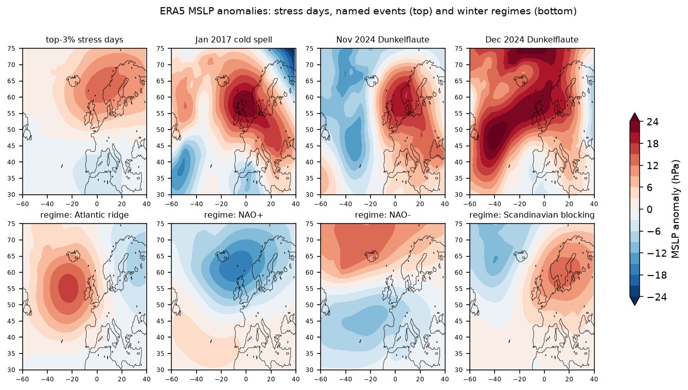
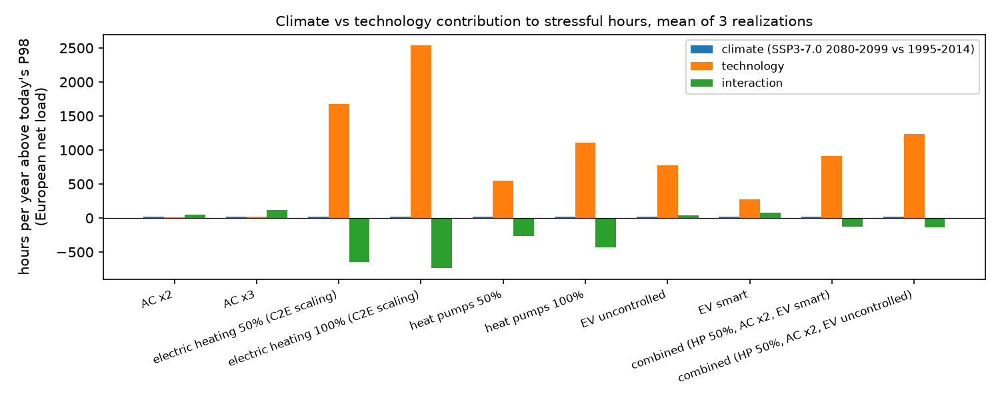
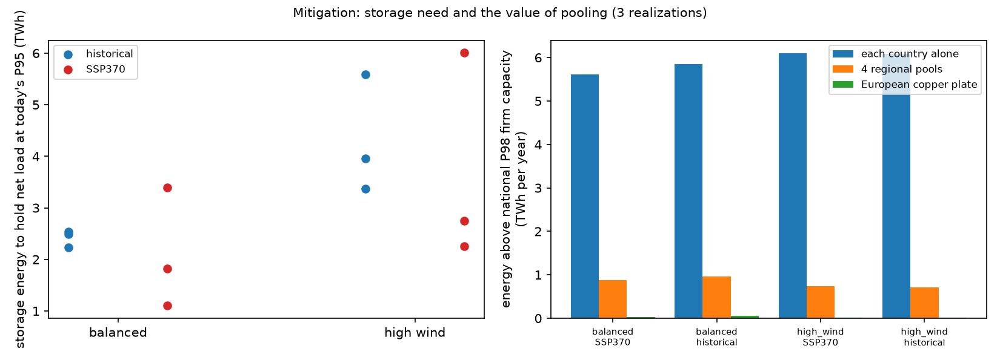
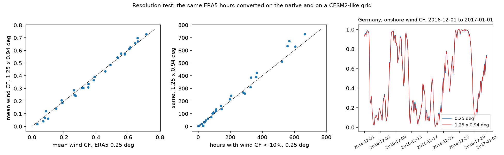
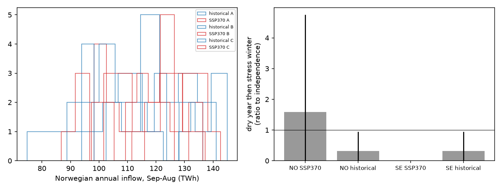

# Stressful events in the European power system under climate change (v0.3)

[](https://github.com/michaelserikov/p12/actions/workflows/tests.yml)

This project starts from stressful periods that the European electricity system has actually lived through in 2015-2025, builds a weather-only stress index that reproduces them, and then asks how such periods change in frequency, duration, severity and spatial extent between the present climate (1995-2014) and the end of the century under SSP3-7.0 (2080-2099). The climate side is [Climate2Energy](https://doi.org/10.1088/2753-3751/ae2870) (C2E): bias-corrected CESM2 converted to country-level wind, solar, heating, cooling and hydro series, three realizations. The net-load set-up follows Bloin-Wibe et al. (2026, ERL, [doi 10.1088/1748-9326/ae5727](https://doi.org/10.1088/1748-9326/ae5727)) and is reproduced first.

v0.1 covers reproducibility (WP0), real events and the stress index (WP1) and present vs future statistics (WP3). v0.2 adds the weather patterns behind the events and their future analogues (WP2), technology trends (WP4) and mitigation options (WP5). v0.3 adds the resolution test towards stretched-grid input (WP6), Nordic hydrology and a paper-style report.

## Main findings (v0.1)

**Real events and a weather-only index (WP1).**
- Today's wind and PV fleet (2024 output per country from ENTSO-E) on ERA5 weather, with a temperature-driven demand model fitted on observed load (R² 0.53-0.91 by country), gives a daily stress index with no market data in it. Over 2015-2025 its anomaly correlates at **0.91** with the observed residual-load anomaly of 16 countries.
- Its top-3% days catch **72%** of the observed residual-load event days (top 3%, within one day), with a false-alarm ratio of 13%.
- Against European price-stress days (at least 4 of 12 zones with a daily price 50% above the 31-day median) in winter, the hit rate is **44%** against 12% for random days (95th percentile 22%), and the rank correlation with the median price ratio is 0.80. The false-alarm ratio is high (73%): many weather-stress days pass without a price spike, so weather alone is a necessary but not a sufficient description of a real event.
- **Tied to prices by regression** (October-March 2015-2025, log price relative to the centred 31-day median, month and weekday effects, Newey-West errors): each +10 GW of the weather-only index raises the day-ahead price by **10.6% in Germany** (t = 18.5), 9.7% in Denmark, 6.3-6.7% in France, Belgium, Czechia and Austria, 1.4% in Italy; the odds of a European price-stress day rise 1.74 times per 10 GW (z = 8.7, 45 event days).
- Named events: the December 2024 Dunkelflaute ranks 17th among the 47 annual maxima of the 3-day index (1979-2025), about a **1-in-2.8-year** weather situation for today's fleet; the January 2017 cold spell about 1-in-2.1 years. The November 2024 Dunkelflaute is **not** extreme in weather terms for the continental pool (every year reaches its index level), although the German daily price rose to 1.9 times its monthly median: its severity came from more than weather (see v0.2 for the circulation pattern).

**Does bias-corrected CESM2 reproduce ERA5 event statistics? (WP1)** Rank-based statistics, 1995-2014, 18 countries, so that the different power curves of C3S and C2E do not matter:
- Frequency of low-wind spells (daily output below its own 10th percentile for at least 2 days): **8.4** per year in ERA5, 8.5-8.8 in the three C2E realizations. Low-portfolio spells (60% wind, 40% PV, below P5): 4.1 vs 3.8-4.0 per year.
- **Persistence is higher in C2E:** lag-3-day autocorrelation of daily wind 0.34-0.36 vs 0.23 in ERA5; the European pool's longest low-wind spell is 12-19 days vs 11 days.
- Spatial coherence is close: pattern correlation of the country-pair correlation matrix 0.95.
- Winter wind and temperature-sensitive demand anomalies are more negatively correlated in C2E (-0.27 to -0.31) than in ERA5 (-0.17). The demand models differ (demand.ninja vs C3S), so this is a flag, not a measurement; it is exactly the compound behaviour that univariate quantile mapping does not constrain.

**Net load: reproduction of the 2026 set-up.** Hours of European net load above the 90th percentile (threshold joint over both periods and all realizations), mean of three realizations, SSP3-7.0 2080-2099 vs 1995-2014:

| Fleet (illustrative, VRE = 80% of demand) | current heating, year | summer | autumn | winter | fully electrified heating, year | winter | spring |
|---|---|---|---|---|---|---|---|
| high wind (80/20) | **+21.6%** (20.0 to 24.0) | +55.5% | +23.2% | -22.3% | -54.0% | **-51.5%** | **-75.0%** |
| balanced (60/40) | +10.3% | +58.0% | +16.0% | -23.8% | -53.2% | -50.6% | -75.1% |
| high solar (30/70) | -2.6% | +116.8% | +5.3% | -21.8% | -53.2% | -50.2% | -78.2% |

The paper reports about +30% high-net-load events for wind-dominated systems with current heating, mostly in summer and autumn, and about -50% in winter and spring for fully electrified net-zero systems. The reproduction gives the same signs, seasons and orders of magnitude; differences in level are expected, because fleets here are stylised (not TYNDP 2024), demand has no TYNDP scaling and reservoir hydro is left out of net load (it enters the PyPSA runs of v0.2).

**Robustness to the bias-correction member.** C2E ships each realization corrected with the quantile maps of every realization. Across all nine combinations the high-wind, current-heating change is +19.6% to +24.0% (mean +21.7%); the spread from the realization (3.6 points on average) is four times the spread from the calibration member (0.8 points).

**Present vs future events (WP3).**
- Country level, balanced fleet, hours above each country's own 98th percentile: a clear north-south split. Italy **+121%** (signal-to-noise 8.6), Austria +70%, Croatia +32%, Spain +26% and Greece +25% gain stress hours; Sweden, Latvia, Estonia, France and Finland lose 36-40%. The sign is the same in all three realizations wherever |signal/noise| exceeds 2.
- Dunkelflaute (daily VRE output below the country's present 3rd percentile for at least 2 days) becomes more frequent in **Great Britain (+72%), Ireland (+68%) and Norway (+47%)**, with signal-to-noise above 2 and the same sign in all three realizations, and less frequent in most continental countries.
- European aggregate events above the joint 98th percentile with current heating are short (mean 2-3 hours, evening peaks); the storage-relevant measure is the annual maximum 7-day mean net load, which falls slightly for the balanced fleet (178 to 164 GW mean over realizations) but rises for the high-wind fleet in all three realizations (161-171 to 169-174 GW).
- Fully electrified heating (C2E scaling, which gives European peaks near 1.3 TW and reads as resistive-equivalent) dominates every statistic it enters; its 20-year return level of event severity drops by an order of magnitude in the future climate. Treat those absolute numbers as an upper bound; v0.2 adds a heat-pump variant.

## Main findings (v0.2): weather patterns, technology and mitigation

**Weather patterns (WP2).** Four winter (November-March) regimes from ERA5 daily mean sea level pressure 1990-2025 (EOFs, k-means):
- On the top-3% days of the stress index, **Scandinavian blocking is 1.8 times more frequent** than on an average winter day (90% interval from resampling whole winters 1.5-2.2) and NAO- 1.5 times (1.1-1.9); NAO+ almost never coincides with stress (0.09). The stress-day composite correlates -0.92 with the NAO+ pattern.
- No trend in the winter frequency of Scandinavian blocking 1990-2025 (Kendall tau -0.04, p 0.71).
- The November 2024 Dunkelflaute is a blocking situation (pattern correlation 0.78); December 2024 and January 2017 sit closer to an Atlantic ridge extending into Europe (0.55 and 0.31).
- **Analogues in the future climate.** Climate2Energy holds no pressure fields, so analogues are searched on what the pressure pattern does to the system: the 3-day pattern of standardized wind, PV and temperature-driven demand anomalies across 32 countries, each dataset standardized against its own present climate. Days as close to each named event as the closest 1% of present-day days occur **about half as often under SSP3-7.0** (9.2 per decade in 1995-2014 against 3.8-4.8 in 2080-2099, mean of three realizations; realization range 2.5-7.0). They do not all become milder: for the December 2024 analogue, the mean European net load on analogue days rises from 153 to 176 GW, and the share of analogue days above today's 98th percentile from 0.37 to 0.67 (realization range 0.50-0.90). The same configuration becomes rarer, but when it happens it is more often a stress event.

**Technology trends (WP4).** European net load with a balanced net-zero fleet resized to each case's demand; stress = hours above today's 98th percentile (today's firm capacity); 2x2 decomposition with the interaction kept explicit (mean of three realizations):

| Case | climate effect (h/yr) | technology effect | interaction | total change |
|---|---|---|---|---|
| air conditioning x2 | +24 | +11 | +54 | +89 |
| air conditioning x3 | +24 | +23 | **+121** | +168 |
| heat pumps 50% | +24 | +548 | -261 | +311 |
| heat pumps 100% | +24 | +1112 | -430 | +706 |
| EV, uncontrolled charging | +24 | +778 | +36 | +837 |
| EV, smart charging | +24 | +275 | +80 | +379 |
| combined (HP 50%, AC x2, EV smart) | +24 | +913 | -126 | +811 |

- With today's technology the climate signal is +24 stress hours a year (+14%). **Air conditioning amplifies it**: alone, tripled AC adds 23 hours, but in the future climate it adds 121 more; in summer the interaction (99 h) is larger than either effect alone. Heat pumps go the other way: warmer winters remove a large part of the stress they would add today.
- Charging behaviour of electric vehicles matters more than the climate signal: uncontrolled charging adds about three times the stress hours of smart charging.
- Electric heating with C2E's full-electrification scaling is shown in `results/wp4` but treated as an upper bound; the heat-pump variant divides it by a COP falling from 3.5 to 2.0 at the cold peak (an assumption, stated in the script).

**Mitigation (WP5).** Balanced and high-wind net-zero fleets, current heating:
- **Pooling is the strongest lever.** Energy above each country's own 98th-percentile firm capacity: 5.6-6.1 TWh a year if every country covers itself, 0.7-1.0 TWh with four regional pools and below 0.1 TWh on a European copper plate; the sum of national peaks exceeds the European peak by about 100 GW (498 vs 400 GW present, balanced fleet). This upper bound ignores grid limits; the PyPSA runs below have them.
- **Storage.** To hold European net load at today's 95th percentile, storage needs about 2.4 TWh (about 14 hours at the needed power) in the present climate and 2.1 TWh in 2080-2099 for the balanced fleet, but the future range across realizations is much wider (1.1-3.4 TWh against 2.2-2.5): internal variability, not the forced signal, sets the storage risk. The high-wind fleet needs more and longer storage (4.3 TWh, 25 hours present; 3.7 TWh, 23 hours future).
- **Firm backup**: European net-load peaks fall slightly (400 to 387 GW balanced, 371 to 363 GW high wind); the 99.9th percentile changes by less than 5 GW.
- **Demand flexibility**: moving 5% of each day's demand within the day lowers the European peak from 413 to 337 GW (realization A, present), 10% to 301 GW.

**Capacity expansion on stress vs normal years (WP5, PyPSA).** The 12-country model of [eu-weather-years-pypsa](https://github.com/michaelserikov/eu-weather-years-pypsa) (transport model with AC and HVDC limits, existing nuclear and hydro, extendable wind, PV, batteries, hydrogen and backup, load shedding at 8000 EUR/MWh, 6-hour steps), driven by Climate2Energy realization A. The stress year has the highest 7-day net load of a fixed balanced fleet, the normal year sits at the median:

| Design year | system cost (bn EUR/yr) | onshore wind (GW) | PV (GW) | battery (GWh) | backup (GW) |
|---|---|---|---|---|---|
| present, stress (1997) | 51.5 | 201 | 205 | 0 | 66 |
| present, normal (1998) | 52.3 | 188 | 222 | 0 | 97 |
| future, stress (2088) | **57.0** | 197 | 245 | 31 | 82 |
| future, normal (2081) | 50.2 | 197 | 190 | 4 | 61 |

Each design operated with fixed capacities on another year:

| Design | operated on | lost load (GWh) | backup energy (TWh) |
|---|---|---|---|
| present normal | present stress year | 37 | 40.6 |
| future normal | future stress year | **3,325** | 89.8 |
| present stress | future stress year | **1,760** | 73.9 |
| future stress | present stress year | 13 | 27.0 |

- In the present climate the year that stresses a fixed fleet is not the year that drives the optimal design (the normal year is even slightly costlier): today's stress is absorbed by backup. Under SSP3-7.0 the stress year costs 13% more to design for than a normal year and adds batteries.
- **A system sized on today's worst year loses 1.8 TWh of load in a future stress year**; one sized on a normal future year loses 3.3 TWh. The reverse direction is harmless (13 GWh). In this model, planning on present-day stress years is not conservative for the end of the century.
- Offshore wind and hydrogen storage stay at zero in all four designs with these costs. One realization and one year per design: an illustration of the mechanism, not a system plan.





## Main findings (v0.3): resolution, Nordic hydrology and the report

**What does climate-model resolution change? (WP6, towards stretched-grid input for Climate2Energy).** Climate2Energy corrects CESM2 on its own 1.25 x 0.94 degree grid against ERA5 regridded to that grid, so a perfectly corrected CESM2 is ERA5 seen at 1.25 x 0.94 degrees. The test converts the same ERA5 hours twice, at 0.25 degrees and after averaging wind components, temperature and radiation to CESM2-sized boxes, with a C2E-style conversion (129 m hub height, generic low-specific-power curve, sites better than the national median, onshore only). **Available so far: December 2016 only** (the other five months are still in the CDS queue; the script reruns on whatever is on disk):
- In flat and coastal countries resolution hardly matters: national best-site wind output changes by -2% to +2.5% in Germany, Poland, the Baltic and Nordic countries, Great Britain, Denmark and France, and the hourly correlation between the two grids is 0.985 or higher.
- **In complex terrain it matters a lot.** Best-site output on the coarse grid is 44% lower in Switzerland, 42% in Slovenia, 37% in North Macedonia, 11-12% in Austria and Romania, and 38% higher in Albania (coarse boxes mix ridges, valleys and sea). The longest low-wind spell (output below 10% for at least 24 hours) grows from 191 to 511 hours in Switzerland and from 94 to 252 hours in Slovenia.
- Hours with wind output below 10% are more frequent on the coarse grid in 18 of 30 countries (median +5%). PV is unaffected at country level (0.047 on both grids), as expected for a near-linear conversion.
- The site-selection step drives part of the gap: averaged over all sites, the two grids agree within 1-2% in the median; the coarse grid blurs the best sites. Extending Climate2Energy to stretched-grid simulations therefore changes the answer most where Alpine and Balkan wind or hydro matter, and for event duration more than for event frequency.

**Nordic hydrology with continental stress (stretch item).** Climate2Energy weekly reservoir inflow, September-August inflow years:
- Mean inflow rises slightly and becomes less variable: Norway 114 to 116 TWh (coefficient of variation 0.14 to 0.11), Sweden 65 to 68 TWh (0.10 to 0.09). Dry years (below the present 20th percentile) fall from 21% to 18% of years in Norway and to 4% in Sweden.
- A dry inflow year followed by a continental stress winter (top 20% of winters by energy above today's P98, Nordic countries excluded) occurs once in 57 present-day and once in 57 future Norwegian inflow years across the three realizations: no evidence of a compound link, but 19 years per realization cannot exclude one.
- Observed check: Norwegian reservoir filling in early October (NVE, 1995-2025) against the stress days of the following winter (ERA5 index, today's fleet): Spearman 0.15 (31 winters); the six lowest-filling autumns are followed by 10.2 stress days on average against 10.7 in all winters. In the observed record low Norwegian reservoirs and continental Dunkelflaute winters are independent.

**Report.** A short paper-style write-up of all results is in [report/report.md](report/report.md) (working report, not peer reviewed).




## Figures (v0.1)


## Method

- **Net load** N = D - G per country and hour (GW). D = weather-insensitive baseline + C2E heating (current electrification, or the fully electrified case) + C2E cooling. The baseline is the OPSD 2015-2019 load climatology by month, weekday flag and hour minus the C2E heating + cooling climatology. G = onshore wind (SWT142 3.15 MW, density corrected) + offshore wind (E-126 7.58 MW) + PV + run-of-river. Each technology's capacity is set so its mean output in the realization's own present climate equals a target energy, so turbine-model level differences cancel and the climate signal in the mean passes through.
- **Fleets.** Current: 2024 wind and PV output by country from ENTSO-E (GB missing after Brexit, Dutch PV missing in ENTSO-E). Net-zero (illustrative): VRE energy = 80% of each country's demand, split 60/40, 80/20 or 30/70 between wind and PV; offshore takes 40% of wind where C2E has offshore output.
- **Events.** Exceedances of a threshold (hourly), gaps of up to 6 hours merged; duration, severity (energy above the threshold), peak; spatial extent (countries simultaneously above their own P98), co-occurrence; GPD return levels of severity (peaks over the 70th percentile); signal-to-noise = change / sqrt(block-bootstrap variance of a 20-year mean in both periods + variance across realizations of the present mean).
- **Weather-only index** (WP1): C3S ERA5 country capacity factors x the 2024 fleet, normalised to the 1991-2025 mean; daily demand per country from HDD (15.5 °C) and CDD (22 °C) with weekday, holiday and trend terms, OLS on observed load 2015-2025, level frozen at 2024.

## Limitations

- One climate model (CESM2), one scenario, three realizations; 20-year periods make return levels beyond 20 years extrapolation.
- Fleets are stylised; there is no TYNDP data here. Reservoir hydro, storage and transmission are not in net load (v0.2 adds them as mitigation).
- The ERA5-C2E comparison uses C3S series that come from different conversion models; only rank-based statistics are compared.
- Observed residual load covers 16 countries (GB left out after 2020-09).

## Reproduce

```
python -m venv .venv && .venv/Scripts/pip install -r requirements.txt && .venv/Scripts/pip install -e . --no-deps
python scripts/run_all.py v0.3
pytest -q
```
Data sources, licences and checksums: [DATA.md](DATA.md), `data_manifest.csv`. Download scripts are in `download/`.

## Licence

Code MIT. Results derive from Climate2Energy (CC-BY 4.0), Copernicus C3S/ERA5, ENTSO-E Transparency and Open Power System Data; see DATA.md.
