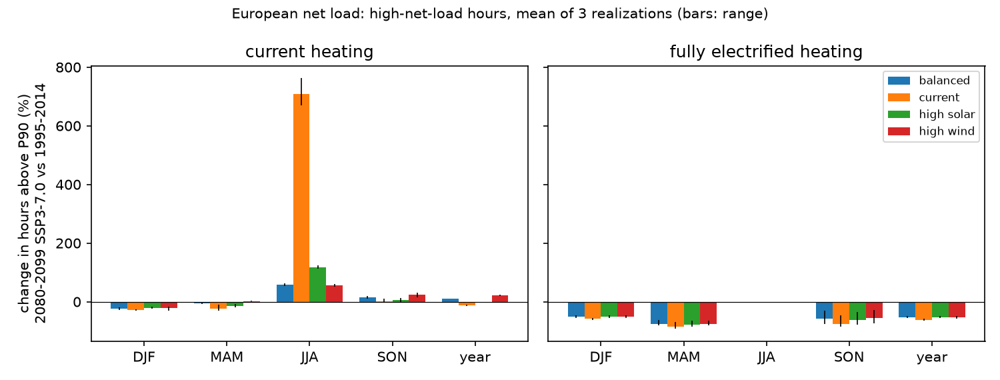
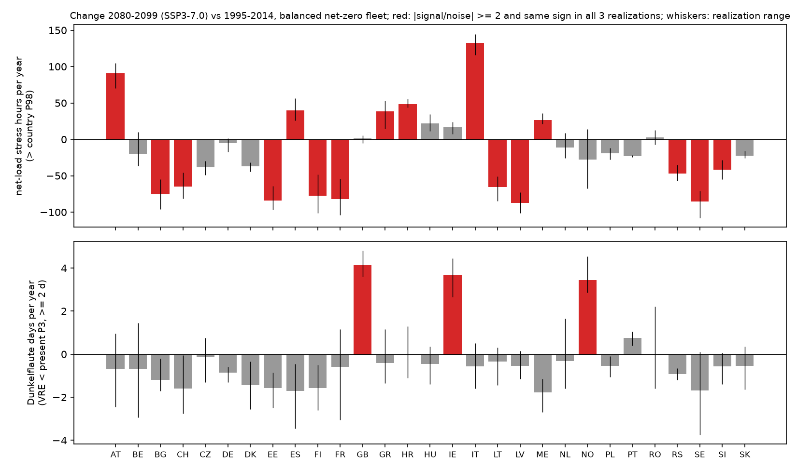
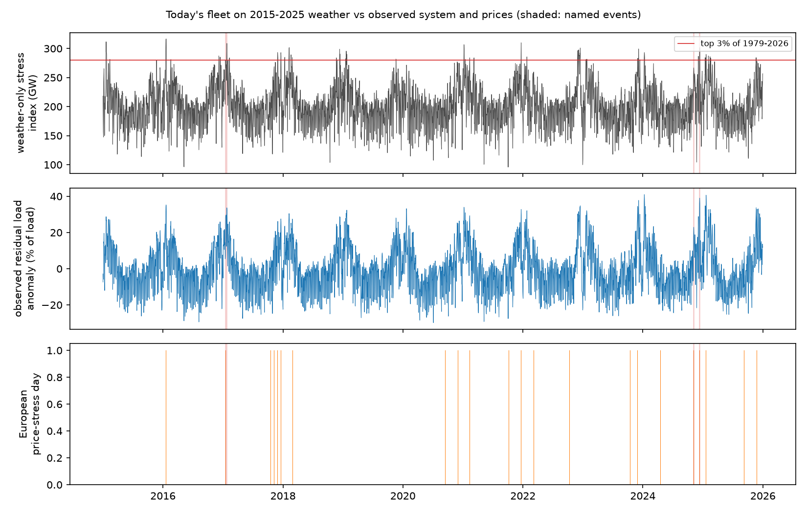
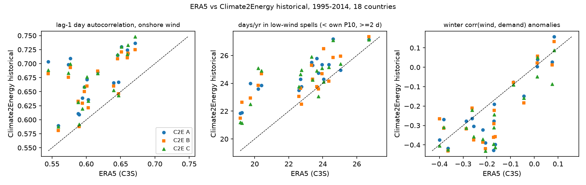

# Stressful events in the European power system under climate change (v0.1)

[](https://github.com/michaelserikov/eu-stress-events/actions/workflows/tests.yml)

This project starts from stressful periods that the European electricity system has actually lived through in 2015-2025, builds a weather-only stress index that reproduces them, and then asks how such periods change in frequency, duration, severity and spatial extent between the present climate (1995-2014) and the end of the century under SSP3-7.0 (2080-2099). The climate side is [Climate2Energy](https://doi.org/10.1088/2753-3751/ae2870) (C2E): bias-corrected CESM2 converted to country-level wind, solar, heating, cooling and hydro series, three realizations. The net-load set-up follows Bloin-Wibe et al. (2026, ERL, [doi 10.1088/1748-9326/ae5727](https://doi.org/10.1088/1748-9326/ae5727)) and is reproduced first.

v0.1 covers reproducibility (WP0), real events and the stress index (WP1) and present vs future statistics (WP3).

## Main findings (v0.1)

**Real events and a weather-only index (WP1).**
- Today's wind and PV fleet (2024 output per country from ENTSO-E) on ERA5 weather, with a temperature-driven demand model fitted on observed load (R² 0.53-0.91 by country), gives a daily stress index with no market data in it. Over 2015-2025 its anomaly correlates at **0.91** with the observed residual-load anomaly of 16 countries.
- Its top-3% days catch **72%** of the observed residual-load event days (top 3%, within one day), with a false-alarm ratio of 13%.
- Against European price-stress days (at least 4 of 12 zones with a daily price 50% above the 31-day median) in winter, the hit rate is **44%** against 12% for random days (95th percentile 22%), and the rank correlation with the median price ratio is 0.80. The false-alarm ratio is high (73%): many weather-stress days pass without a price spike, so weather alone is a necessary but not a sufficient description of a real event.
- Named events: the December 2024 Dunkelflaute ranks 17th among the 47 annual maxima of the 3-day index (1979-2025), about a **1-in-2.8-year** weather situation for today's fleet; the January 2017 cold spell about 1-in-2.1 years. The November 2024 Dunkelflaute is **not** extreme in weather terms for the continental pool (every year reaches its index level), although the German daily price rose to 1.9 times its monthly median: its severity came from more than weather (see v0.2 for the circulation pattern).

**Does bias-corrected CESM2 reproduce ERA5 event statistics? (WP1)** Rank-based statistics, 1995-2014, 18 countries, so that the different power curves of C3S and C2E do not matter:
- Frequency of low-wind spells (daily output below its own 10th percentile for at least 2 days): **8.4** per year in ERA5, 8.5-8.8 in the three C2E realizations. Low-portfolio spells (60% wind, 40% PV, below P5): 4.1 vs 3.8-4.0 per year.
- **Persistence is higher in C2E:** lag-3-day autocorrelation of daily wind 0.34-0.36 vs 0.23 in ERA5; the European pool's longest low-wind spell is 12-19 days vs 11 days.
- Spatial coherence is close: pattern correlation of the country-pair correlation matrix 0.95.
- Winter wind and temperature-sensitive demand anomalies are more negatively correlated in C2E (-0.27 to -0.31) than in ERA5 (-0.17). The demand models differ (demand.ninja vs C3S), so this is a flag, not a measurement; it is exactly the compound behaviour that univariate quantile mapping does not constrain.

**Net load: reproduction of the 2026 set-up.** Hours of European net load above the 90th percentile (threshold joint over both periods and all realizations), mean of three realizations, SSP3-7.0 2080-2099 vs 1995-2014:

| Fleet (illustrative, VRE = 80% of demand) | current heating, year | summer | autumn | winter | fully electrified heating, year | winter | spring |
|---|---|---|---|---|---|---|---|
| high wind (80/20) | **+21.6%** (20.0 to 24.0) | +55.5% | +23.2% | -22.3% | -54.0% | **-51.5%** | **-75.0%** |
| balanced (60/40) | +10.3% | +58.0% | +16.0% | -23.8% | -53.2% | -50.6% | -75.1% |
| high solar (30/70) | -2.6% | +116.8% | +5.3% | -21.8% | -53.2% | -50.2% | -78.2% |

The paper reports about +30% high-net-load events for wind-dominated systems with current heating, mostly in summer and autumn, and about -50% in winter and spring for fully electrified net-zero systems. The reproduction gives the same signs, seasons and orders of magnitude; differences in level are expected, because fleets here are stylised (not TYNDP 2024), demand has no TYNDP scaling and reservoir hydro is left out of net load (it is a mitigation option in v0.2).

**Present vs future events (WP3).**
- Country level, balanced fleet, hours above each country's own 98th percentile: a clear north-south split. Italy **+121%** (signal-to-noise 8.6), Austria +70%, Croatia +32%, Spain +26% and Greece +25% gain stress hours; Sweden, Latvia, Estonia, France and Finland lose 36-40%. The sign is the same in all three realizations wherever |signal/noise| exceeds 2.
- Dunkelflaute (daily VRE output below the country's present 3rd percentile for at least 2 days) becomes more frequent in **Great Britain (+72%), Ireland (+68%) and Norway (+47%)**, with signal-to-noise above 2 and the same sign in all three realizations, and less frequent in most continental countries.
- European aggregate events above the joint 98th percentile with current heating are short (mean 2-3 hours, evening peaks); the storage-relevant measure is the annual maximum 7-day mean net load, which falls slightly for the balanced fleet (178 to 164 GW mean over realizations) but rises for the high-wind fleet in all three realizations (161-171 to 169-174 GW).
- Fully electrified heating (C2E scaling, which gives European peaks near 1.3 TW and reads as resistive-equivalent) dominates every statistic it enters; its 20-year return level of event severity drops by an order of magnitude in the future climate. Treat those absolute numbers as an upper bound; v0.2 adds a heat-pump variant.






## Method

- **Net load** N = D - G per country and hour (GW). D = weather-insensitive baseline + C2E heating (current electrification, or the fully electrified case) + C2E cooling. The baseline is the OPSD 2015-2019 load climatology by month, weekday flag and hour minus the C2E heating + cooling climatology. G = onshore wind (SWT142 3.15 MW, density corrected) + offshore wind (E-126 7.58 MW) + PV + run-of-river. Each technology's capacity is set so its mean output in the realization's own present climate equals a target energy, so turbine-model level differences cancel and the climate signal in the mean passes through.
- **Fleets.** Current: 2024 wind and PV output by country from ENTSO-E (GB missing after Brexit, Dutch PV missing in ENTSO-E). Net-zero (illustrative): VRE energy = 80% of each country's demand, split 60/40, 80/20 or 30/70 between wind and PV; offshore takes 40% of wind where C2E has offshore output.
- **Events.** Exceedances of a threshold (hourly), gaps of up to 6 hours merged; duration, severity (energy above the threshold), peak; spatial extent (countries simultaneously above their own P98), co-occurrence; GPD return levels of severity (peaks over the 70th percentile); signal-to-noise = change / sqrt(block-bootstrap variance of a 20-year mean in both periods + variance across realizations of the present mean).
- **Weather-only index** (WP1): C3S ERA5 country capacity factors x the 2024 fleet, normalised to the 1991-2025 mean; daily demand per country from HDD (15.5 °C) and CDD (22 °C) with weekday, holiday and trend terms, OLS on observed load 2015-2025, level frozen at 2024.

## Limitations

- One climate model (CESM2), one scenario, three realizations; 20-year periods make return levels beyond 20 years extrapolation.
- Fleets are stylised; there is no TYNDP data here. Reservoir hydro, storage and transmission are not in net load (v0.2 adds them as mitigation).
- The ERA5-C2E comparison uses C3S series that come from different conversion models; only rank-based statistics are compared.
- Observed residual load covers 16 countries (GB left out after 2020-09).

## Reproduce

```
python -m venv .venv && .venv/Scripts/pip install -r requirements.txt && .venv/Scripts/pip install -e . --no-deps
python scripts/run_all.py v0.1
pytest -q
```
Data sources, licences and checksums: [DATA.md](DATA.md), `data_manifest.csv`. Download scripts are in `download/`.

## Licence

Code MIT. Results derive from Climate2Energy (CC-BY 4.0), Copernicus C3S/ERA5, ENTSO-E Transparency and Open Power System Data; see DATA.md.
